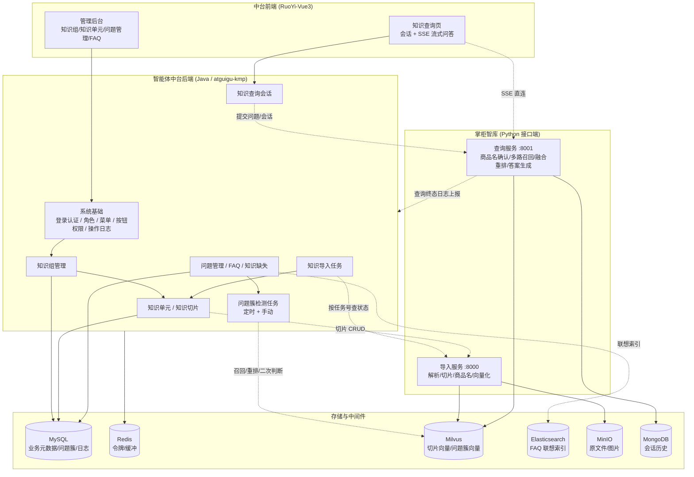
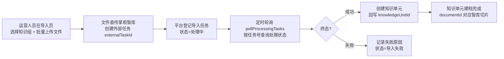
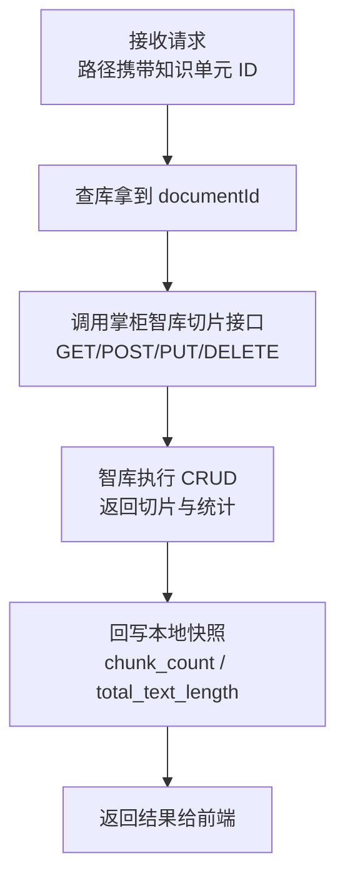
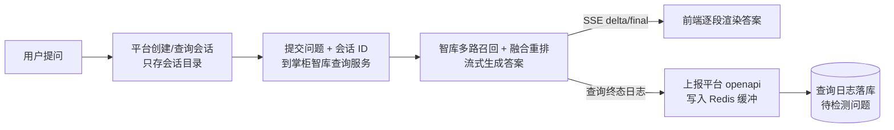
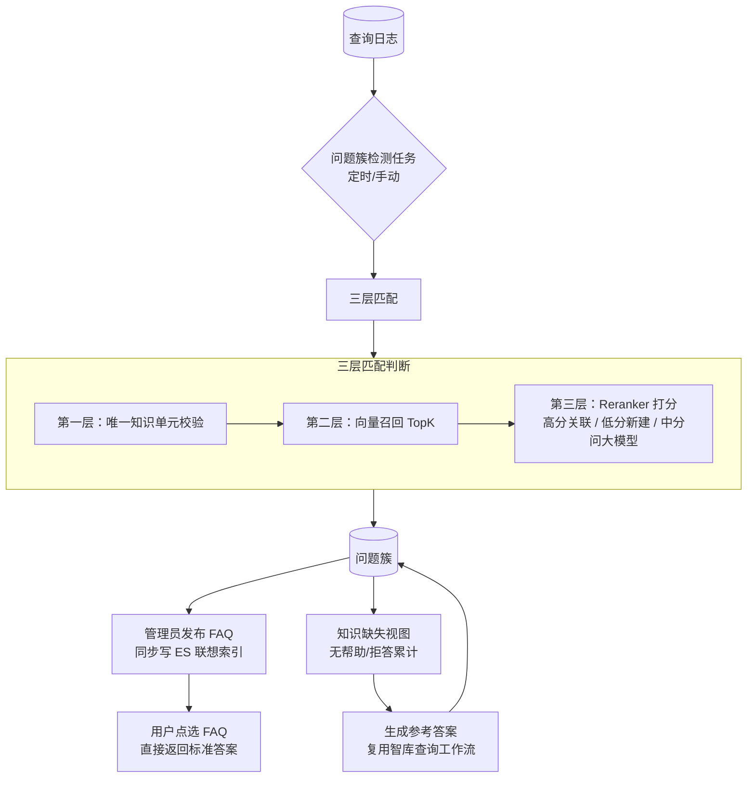
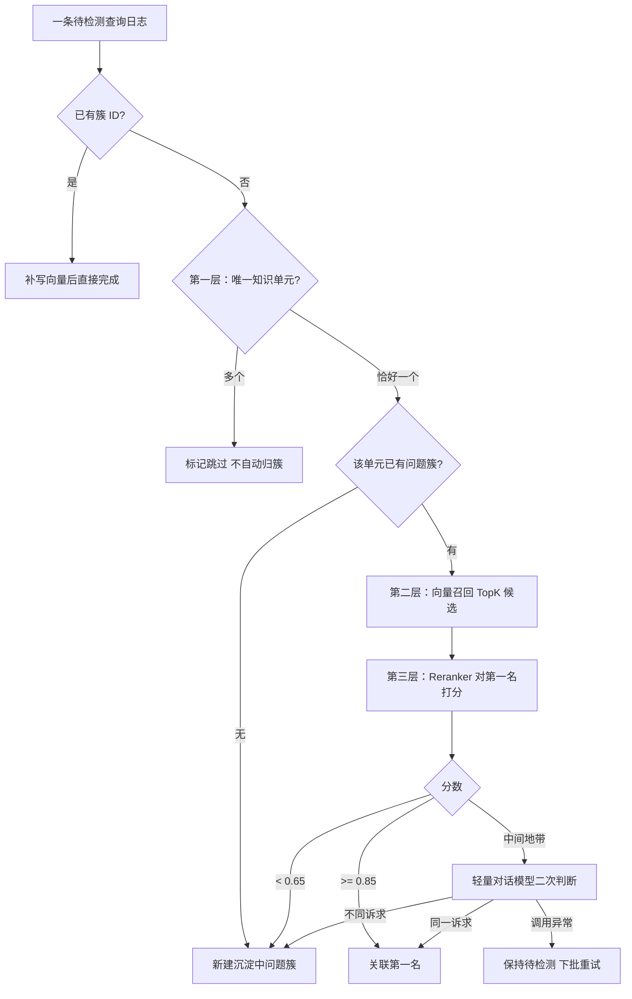

# 智能体中台项目总结

---

# 第1章 项目架构图

智能体中台是一个基于若依（RuoYi）的前后端分离平台。Java 后端负责权限、业务数据和与掌柜智库的协作；掌柜智库（Python）负责文档解析、向量化入库、检索召回和答案生成这些“智能体”能力；前端负责管理后台和知识查询交互。

**读图要点：**

- 智能体中台是“管理与协作层”，掌柜智库是“智能体能力层”。两者通过 HTTP 接口协作，各自维护自己的存储职责。
- 平台的 MySQL **只保存索引和元数据**（知识单元、会话目录、问题簇、检测任务、查询日志），切片正文和问答正文都交给掌柜智库保存，避免两套存储职责混淆。
- 前端的流式问答走 SSE 直连掌柜智库查询服务；其余管理类操作走 Java 后端。

---

# 第2章 项目串讲稿

## 项目介绍

智能体中台这个项目，是在已有的知识库系统（掌柜智库）之上，开发的一套**面向管理员的知识生产与运营后台**。掌柜智库本身已经能解析文档、做向量检索、生成答案，但它缺一层“谁能登录、谁能维护知识、查询效果如何”的统一管理能力。智能体中台就是补上这一层。

从整体上看，我负责的是 Java 后端这一侧，可以分成三块来讲：

1. **系统基础**：基于若依的登录认证、用户、角色、菜单、按钮权限和操作日志，保证平台可管可控、可审计。
2. **知识资产管理**：知识组、知识单元、知识切片、知识导入任务、知识查询会话这些业务数据的维护，以及与掌柜智库接口的协作。
3. **知识运营闭环**：问题管理（问题簇）、FAQ 发布与联想、点选 FAQ、问题簇检测任务、知识缺失、查询日志上报，这一套把“真实问答”沉淀成“可复用 FAQ”的智能体运营链路。

一句话概括：这个平台把散落在文档里的知识，通过“导入 → 建档 → 检索 → 反馈 → 归纳 → 发布”的闭环，沉淀成可管理、可复用、可运营的知识资产。

## 知识导入与建档流程

平台的“知识入库”不是把正文存进自己的库，而是**登记任务 + 跟踪状态 + 成功后建档**。

- 导入任务表 `kmp_knowledge_import_task` 更像一本“任务流水账”：记录谁准备导入哪个文件、属于哪个知识组、外部任务号是多少、当前处理到哪一步。
- Java 后端通过定时任务轮询掌柜智库的处理状态，成功就创建知识单元并回写 ID，失败就记录失败原因，超过时限的无效任务由清理任务回收。
- 知识单元 `kmp_knowledge_unit` 只保存文档元数据（名称、所属知识组、原始文件 SHA-256、下载地址、切片数与文本总长快照），正文交给掌柜智库。`documentId` 是连接平台与智库切片的关键锚点。

## 知识切片维护流程

知识切片是“一份文档拆出来的若干段落”。**切片正文不存在平台，而是存在掌柜智库**，平台凭 `documentId` 通过 HTTP 调用智库接口做增删改查，再由智库返回统计信息回写本地快照。

这样平台侧不保存大段文本，切片统计快照也能在每次写操作后与智库对齐，保证一致性。

## 知识查询流程

知识查询页面把“会话管理”和“流式问答”分开处理：

- 平台表 `kmp_knowledge_query_session` 只保存会话标题和归属用户，不保存问题列表和回答列表，完整问答由掌柜智库负责。
- 查询服务返回答案后，会把本次查询的终态信息（改写问题、命中商品名、Token 用量、回答类型等）通过开放接口上报给平台，落入查询日志表，成为后续“问题簇检测”的输入。
- 用户对正常回答可以点“有帮助 / 无帮助”，这个反馈会写回查询日志，是“知识缺失”运营的重要来源之一。

## 知识运营闭环（问题簇与 FAQ）

这是整个智能体中台最有“智能体运营”色彩的部分：**把真实问答里反复出现的问题，自动归纳成问题簇，再由管理员审核发布成 FAQ**，让常见问题下次可以直接点选命中，不用再走大模型生成。

- 检测任务采用“提交即返回、后台串行执行”的两阶段异步模式：用户请求线程只负责建任务记录、扔进线程池队列并立即返回 taskId；后台 worker 线程取出任务，逐题匹配、建簇或关联，最后写统计结果。
- 单题匹配走三层判断：先确认问题只属于一个唯一知识单元；再在该知识单元的已有问题簇里做向量召回；最后用 Reranker 分数决定关联已有簇、新建簇，还是把中等分数的模糊情况交给大模型二次判断。
- 已发布的问题簇就是用户能在查询页点选的 FAQ。发布时同步把标准问题写入 Elasticsearch 联想索引，取消发布时同步删除；MySQL 始终是发布状态的“事实来源”，ES 只是辅助全文索引。
- 对反复“无帮助”或“资料缺失拒答”的问题，平台在“知识缺失”视图里挑出来，管理员补充标准答案（可用“生成参考答案”按钮复用智库工作流实时草拟），处理后发布成 FAQ，形成完整闭环。

## 项目整体总结

智能体中台是一个基于若依的知识库智能体管理平台，主要解决企业知识“有资料但难管理、能回答但难沉淀”的问题。它在掌柜智库这套 RAG 能力之上，补齐了权限管理、知识资产管理和知识运营闭环三层能力。

我主要负责 Java 后端，可以拆成三条主线：

- **系统基础**：登录认证、角色、菜单、按钮权限、操作日志，保证平台可管、可控、可审计。
- **知识资产管理**：知识组、知识单元、知识切片、导入任务、查询会话。这里的核心设计思想是“平台只存元数据和索引，正文交给智库”，通过 `documentId`、`externalTaskId`、`session_id` 这些外部 ID 做衔接，用定时轮询和统计快照保证最终一致。
- **知识运营闭环**：查询日志上报、问题簇检测、三层问题匹配、FAQ 发布与联想、点选 FAQ、知识缺失、生成参考答案。这条链路把“真实问答”不断沉淀成“可复用 FAQ”，是智能体从“能回答”走向“越用越省”的关键。

整体上，这个项目的价值不在于重新实现一套 RAG，而在于把一个文档问答系统，工程化地升级成了**可管理、可运营、可持续自我沉淀的知识智能体平台**。

---

# 第3章 项目相关指标数据

## 3.1 技术选型与部署配置

| 模块 | 配置 |
| --- | --- |
| 中台后端 | Java 17、Spring Boot 3.5、Spring Security + JWT、MyBatis-Plus 3.5，若依多模块工程 + 独立业务模块 `atguigu-kmp` |
| 中台前端 | RuoYi-Vue3（Vite + Element Plus），管理后台 + 知识查询会话页 |
| 智能体能力端 | 掌柜智库：FastAPI 双服务（导入 :8000 / 查询 :8001），LangGraph 编排导入与查询工作流 |
| 业务数据库 | MySQL 8（Druid 连接池），保存知识组、知识单元、导入任务、会话目录、问题簇、检测任务、查询日志 |
| 缓存与缓冲 | Redis：登录令牌、验证码、查询日志异步缓冲 |
| 向量检索 | Milvus：智库侧存切片向量；中台侧存问题簇向量（1024 维稠密向量，余弦相似度） |
| 全文检索 | Elasticsearch（内置 ik 分词）：FAQ 联想索引，只存问题簇 ID 和标准问题 |
| 对象存储 | MinIO：原始文件与图片，平台侧保存外部可读下载 URL |
| 会话历史 | MongoDB：多轮问答历史，由智库侧读写 |
| 任务调度 | Spring `@Scheduled`（导入状态轮询）+ 若依 Quartz（问题簇周期检测，每小时整点） |
| 模型服务 | 一律以远程 API 形式接入（百炼系：向量转换、重排、轻量对话模型），平台不做模型部署，项目也不涉及模型底层实现 |
| 容器环境 | Docker Compose 一键拉起 MySQL/Redis/ES/Milvus/MinIO/MongoDB 等 10 个服务 |

## 3.2 关键工程参数口径

| 参数 | 取值 | 说明 |
| --- | --- | --- |
| 问题簇匹配高分阈值 | 0.85 | Reranker 分数 ≥ 0.85 直接关联第一名 |
| 问题簇匹配低分阈值 | 0.65 | < 0.65 直接新建问题簇；介于两者之间交给大模型二次判断 |
| 向量召回候选数 | TopK 可配置 | 按知识单元标量过滤后召回候选问题簇 |
| FAQ 联想触发条件 | 输入 ≥ 5 字符 | 返回最多 10 条、相关度 ≥ 0.60 的候选问题 |
| 导入状态轮询 | 间隔可配置（秒级） | 同步处理中任务终态；清理待上传/失败超过 30 分钟的任务 |
| 检测任务窗口 | 上一整点 ~ 当前时刻 | Quartz 每小时整点处理截止整点的待检测问题 |
| 检测执行器 | 单线程 + 队列 100 + AbortPolicy | 串行防止重复建簇和计数错乱；队列满则任务提交失败 |
| 跨系统超时 | 连接 5~10s / 读取 30~60s | RestClient 分服务配置，生成答案类接口读超时放宽 |

## 3.3 数据与规模口径（基本假设）

| 类型 | 数量（假设口径） |
| --- | --- |
| 平台角色 | 管理员、知识运营、普通查询用户，按菜单 + 按钮权限划分 |
| 知识组 | 数十个，默认知识组全局唯一 |
| 知识单元（已导入资料） | 数千份文档，单文档切片数十到数千条 |
| 查询日志 | 日均数千次问答，含 Token 用量、首 Token 时间等指标字段 |
| 问题簇 | 万级以内，其中已发布 FAQ 占比持续上升 |
| FAQ 点选命中率 | 上线后重点观察指标：常见问题逐步从“走模型”迁移到“点选 FAQ”，降低模型调用量 |

---

# 第4章 项目背景与使用情况

**请简单介绍一下智能体中台这个项目。**

智能体中台是知识库智能体管理平台，基于若依前后端分离架构。它本身不做文档解析和答案生成——这些“智能体能力”由掌柜智库提供；中台负责的是能力之外的一切：登录认证与按钮级权限、知识组/知识单元/切片的资产管理、知识导入任务的状态跟踪、查询会话管理，以及把真实问答沉淀成 FAQ 的知识运营闭环（问题簇检测、三层匹配、FAQ 发布、点选命中、知识缺失处理）。两个系统通过 HTTP 契约协作，各管各的存储。

**这个项目解决什么问题？**

解决三个问题：一是知识库“能回答但没法管”——谁维护了哪些资料、归属哪个知识组、切片对不对，没有后台可查可改；二是查询“有出口但没有反馈闭环”——用户问了什么、答得好不好、哪些知识缺失，看不到也追不了；三是知识“一次一次现答”——高频问题每次都要走完整检索和大模型生成，成本高、答案不稳定。中台把这三块补上，让知识资产可管理、问答效果可度量、高频问题可沉淀复用。

**项目做完后是否真的有人使用？**

有。运营人员在导入页批量上传资料并跟踪任务状态；管理员在问题管理里审核、发布 FAQ；知识查询页的热门推荐和输入联想直接服务终端用户。上线后重点观察 FAQ 点选命中情况、知识缺失清单的处理进度、以及无帮助和拒答问题的收敛速度。项目还通过定时检测任务持续把新问答归入问题簇，运营侧形成“看缺失 → 补答案 → 发布 FAQ”的日常工作流。

**为什么基于若依二次开发，而不是自己搭一套管理后台？**

管理后台的核心成本在系统基础：JWT 认证、RBAC、菜单和按钮权限、操作日志、数据字典、定时任务。若依把这些都做好了且经过大量生产验证，我们只需要新增独立业务模块 `atguigu-kmp`，业务包与若依包隔离（启动类双根包扫描），既复用了权限审计能力，又不污染框架代码。

**中台为什么自己还要接 Milvus 和 ES，而不是全部交给智库？**

职责不同。智库的 Milvus 集合存的是文档切片向量，服务于 RAG 检索；中台的 Milvus 集合只存问题簇向量（问题簇 ID、知识单元 ID、名称、向量四个字段），服务于“问题归簇”这一运营场景。FAQ 联想用 ES 是因为它是全文分词匹配场景，需要的是关键词联想而不是语义检索，用 ES 更对口、成本更低。

---

# 第5章 跨系统协作与接口对接

**中台和掌柜智库的一致性怎么保证？两边各存一份数据，会不会不一致？**

首先明确“谁是谁的事实来源”：切片正文和问答正文只在智库一份存储里，平台只存元数据和统计快照，天然没有双写正文的一致性问题。对必须协作的地方做了三层保障：导入任务靠定时轮询同步终态（幂等：已终态的任务不再更新）；切片统计快照在每次 CRUD 后用智库返回的权威统计回写；问题簇向量写入失败时，日志里已先记下簇 ID，下轮检测只“补写向量”而不重复建簇。

**导入任务为什么要设计五个状态？状态机怎么走的？**

待上传 → 上传中 → 处理中 → 导入成功 / 导入失败。前面状态跟用户操作走，平台只登记；“处理中”之后主动权在智库，平台通过轮询推进终态。这样设计的好处是：文件上传和解析这种长耗时操作不占用任何请求线程，用户刷新任务列表就能看进度；失败任务带失败原因，可定位可清理（超过 30 分钟的待上传/失败任务由清理任务回收）。

**跨系统的 JSON 契约，字段命名对不上怎么办？**

智库 JSON 用下划线风格（`chunk_id`、`document_id`），Java 属性是驼峰。做法是给 DTO 显式声明契约：`@JsonProperty` 定正式字段名（控制收发两个方向），`@JsonAlias` 只放开入参别名（兼容前端驼峰）。Python 侧对称地用 Pydantic `Field(alias=...)` 兼容 Java 发来的驼峰，响应再按 alias 输出，保证链路两端各自习惯、契约点严格对齐。

**Java 调 Python 接口踩过什么坑？**

两个典型的：一是 RestClient 发送对象请求体时，若不显式设置 `Content-Type: application/json`，可能被内容协商序列化成 XML 导致对方 400；二是反序列化泛型响应（`ExternalResponse<T>`）必须用 `ParameterizedTypeReference` 保留泛型信息，否则 `data` 会被解析成 `LinkedHashMap` 拿不到目标类型。这两点都已形成项目规范：跨系统调用统一显式指定 JSON 类型。

**为什么前端流式问答直连智库 8001，而不是全部经 Java 中台转发？**

SSE 长连接经 Java 转发会长时间占用 Web 容器线程，且若依侧还要处理鉴权上下文的透传，链路过重。现在的分工是：会话的“目录管理”（建会话、列表、删除）走 Java 中台，落 MySQL 做用户归属隔离；“问答流”由前端直连智库 SSE（提交任务后按 task_id 建立 EventSource，收 ready/progress/delta/final 事件）。查询终态再由智库上报中台开放接口补录日志，管理属性和实时体验两头都顾到。

**查询日志上报是匿名开放接口，安全怎么考虑？**

接口只收终态事实（请求 ID、时间、Token 数、回答类型等），不含任何可写业务状态；入参强校验（时间必须带时区、状态枚举范围限制）；写入采用异步缓冲（Redis Stream 思路）削峰，避免外部流量直接打库。后续如果加固，可以加接口签名或 IP 白名单，这属于演进方向。

**为什么日志里的时间要用 OffsetDateTime 而不是 LocalDateTime？**

跨系统传时间必须能还原成唯一真实时刻。LocalDateTime 只是“纸面时间”，没有时区语义；OffsetDateTime 带偏移量，平台收到后统一换算成上海时间再落库。否则智库和平台部署在不同时区（或夏令时）时，统计窗口和检测任务窗口就会错位。

**chunkId 为什么定义成 String 而不是 Long？**

JS 的 Number 只能精确表示 2^53-1 以内的整数，雪花类长整型 ID 传到浏览器会丢精度，前端拿着“变了形”的 ID 回来就找不到切片。跨前端传输的外部 ID 统一用字符串透传、不做数值解析，从源头规避。

---

# 第6章 知识查询与反馈

**平台为什么不保存会话的问题和回答正文？**

正文的多轮上下文管理、历史回放都由智库（MongoDB）负责，平台重复存一份只会带来同步负担。平台的 `kmp_knowledge_query_session` 只保存会话标题和归属用户，充当“会话目录”：用户在自己的会话列表里点进任意会话，前端再凭会话 ID 到智库拉历史。存储职责清晰，两边都不别扭。

**会话列表为什么强调“本人”？用户 ID 从哪来？**

所有会话查询都以当前登录用户为过滤条件，且用户 ID 一律从登录上下文（`getUserId()`）读取，绝不信任请求参数。调用方即使伪造 `createUserId` 也不会进入查询条件，从接口层面堵死越权查看他人会话的口子。

**“有帮助/无帮助”反馈接口的校验顺序是什么？**

先验反馈值合法性 → 按 requestId 查日志 → 验归属（日志必须属于当前用户）→ 验回答类型（只有正常回答可评价，拒答和澄清不可）→ 相同反馈重复提交幂等返回、不刷更新时间。“日志不存在”和“不属于当前用户”返回同一个提示，避免别人拿 requestId 探测他人的记录。

**反馈按钮的显示条件为什么在前端也做一套？**

只有 AI 生成（非 FAQ 点选）、流式已完成、有正文、回答类型为正常回答且已拿到 requestId 时才显示。前端条件是体验优化，后端校验才是事实防线，两边口径一致但职责不同。

---

# 第7章 问题簇与检测任务

**问题簇有哪几种来源？**

两种：管理员手工创建（填标准问题、答案、审核发布）；检测任务从真实查询日志里自动归簇。一个已发布的问题簇就是用户可见可点选的 FAQ。

**讲一下单题匹配的三层判断。**

要点：模型只在“中等分数带”这一个点上做判断，关联还是新建由系统按阈值和模型结论执行；模型调用异常不会误建簇，日志保持待检测等下批重试，把不确定性留给可恢复路径。

**为什么新建问题簇的顺序是“先存 MySQL → 回写日志簇 ID → 再写向量”？**

按“失败最好恢复”的方向排。MySQL 簇先落，向量的幂等重试键（簇 ID）就已存在；中途失败时日志里的簇 ID 让下一轮只做“补写向量”，绝不重复建簇。若反过来先写向量，失败后既可能产生孤儿向量又无法幂等定位。

**检测任务为什么拆成“提交”和“执行”两阶段？**

一次检测要扫描窗口内全部日志并逐题过召回、重排甚至大模型判断，耗时可能几分钟，绝不能在用户请求线程里做。提交阶段毫秒级返回 taskId（建记录 + 入队），执行阶段由后台线程池消化。两阶段之间只靠“队列 + 数据库任务记录”交接，前端轮询任务列表看进度。队列满被拒绝时任务直接置失败并写明原因，用户可见可解释。

**为什么执行器是单线程？不怕慢吗？**

故意单线程。归簇涉及“查询已有簇 → 判断 → 建簇/关联 → 更新计数”，并发跑会重复建簇、计数错乱。检测每小时跑一次，单批问题量有限，串行完全够用；正确性优先于吞吐。Quartz 周期任务和手动任务是同一执行入口，Quartz 走“上一整点截止”的窗口，天然避免两个入口重叠处理（窗口不交叠 + 执行前校验状态仍为待执行，防重入）。

**单题失败会不会拖垮整批？**

不会。逐题处理时异常只计入失败数并留日志，该题保持待检测留给下批重试，批次继续；只有批次级异常才把任务置为失败。任务表记录各项统计数字（匹配、新建、跳过、失败），执行结果可审计。

**问题簇的向量集合为什么只有四个字段，问题正文存 MySQL？**

Milvus 只承担“相似问题召回”一件事：ID 过滤 + 向量检索。把正文放进向量库会带来冗余存储和同步负担；召回拿到候选簇 ID 后，回 MySQL 取全文再交给重排和二次判断，各存储只做自己擅长的事。

---

# 第8章 FAQ 发布、联想与热度

**发布 FAQ 时 MySQL 和 ES 双写，顺序和失败怎么处理？**

先更新 MySQL 状态（带旧状态条件的乐观更新，防并发重复发布），再写 ES 联想索引；ES 写失败抛异常，MySQL 事务回滚。状态更新用“旧状态 = 沉淀中或待发布”作为更新条件，本身就是幂等护栏：已发布的簇重复点发布不会执行任何操作。取消发布对称处理：MySQL 状态回退 + ES 文档删除。

**为什么说 MySQL 是“事实来源”，ES 只是辅助？**

ES 只存问题簇 ID 和标准问题两个字段，用来做联想匹配。所有出口都要回 MySQL 复核：联想结果拿候选 ID 回查“已发布”状态后才输出——防止已下架 FAQ 因 ES 未同步而继续展示；点选 FAQ 读答案时同样先复核发布状态，已失效的直接提示刷新。计数（曝光、点击、好评）也全在 MySQL。

**热门 FAQ 的“热度分”怎么算？**

按关联次数、点击量、点击率、好评率加权计算，SQL 内直接算分排序，同分再按关联次数、点击次数兜底。展示热门榜的同时累计曝光次数，曝光又回流到热度分，形成“越有用越靠前”的正反馈。运营侧还能通过热度识别真正的高频刚需 FAQ。

**点选 FAQ 为什么值得单独做一条链路？**

用户不输自由问题，直接点热门推荐或联想出来的标准问题，平台直接返回已发布的标准答案——零模型调用、零检索链路，毫秒级响应且答案绝对稳定。这是整个运营闭环“省成本”的兑现点：问题簇检测发布得越多，走大模型的比例就越低。点选同时累加点击计数；计数失败不阻断答案返回，只告警留痕（答案体验优先，统计可事后对账）。

**FAQ 联想为什么设“至少 5 字符、相关度 ≥ 0.60、最多 10 条”？**

少于 5 字符的分词几乎没有区分度，返回一堆噪音反而干扰输入；相关度阈值和条数上限是为了让联想框保持“准而少”。这三个参数都是配置化经验值，可按线上点击分布调参。

---

# 第9章 知识缺失与生成参考答案

**“知识缺失”列表的数据是哪来的？**

不新建一套问题数据，而是问题簇上的一个运营视图：只筛“无帮助累计 + 资料缺失拒答累计 > 0”的问题簇，按缺失合计降序。无帮助来自用户反馈，拒答来自智库侧的断崖截断机制（候选上下文全部低于阈值时返回拒答并上报日志）。列表复用问题簇的实体、Mapper 和状态校验，只加缺失条件和排序。

**发现知识缺失后，运营的处理动作是什么？**

进入处理页查看缺失来源、累计次数和最近关联问题；补充标准答案（可点“生成参考答案”草拟）；确认后保存并发布成 FAQ。下一条同类问题就会被联想或热门命中，不再消耗模型调用。

**“生成参考答案”是怎么实现的？为什么不落库？**

管理员点按钮后，Java 组装问题簇的标准问题和文档 ID，调用智库查询服务的内部接口；智库复用完整的 LangGraph 查询工作流（商品名确认、多路召回、融合重排、答案生成）实时生成一段答案，逐层返回后**只回填前端“标准答案”文本框**，不落库。生成的只是“草稿”，管理员编辑确认后才手工保存——AI 提效但不代替人做发布决策，这是发布质量的护栏。实现上有个关键点：Python 路由用同步 `def` 让 FastAPI 放到线程池执行，避免长耗时工作流阻塞事件循环；生成接口读超时单独放宽到 60 秒，且答案生成走 8001 查询服务（复用查询侧完整链路）。

**契约变更时前后端怎么对齐？**

链路上三段契约必须逐点核对：前端读 `response.data.referenceAnswer`，Java 响应用键 `referenceAnswer`，Python 响应用 Pydantic alias 输出驼峰。新接口上线用一条手工链路（前端按钮 → Java → Python → 回填）端到端验证，而不是只看单侧接口文档。

---

# 第10章 权限、安全与工程规范

**平台的权限体系是怎么设计的？**

三层：认证层用 Spring Security + JWT（令牌存 Redis，支持过期续期与登出失效）；授权层用 RBAC 到按钮粒度，接口上 `@PreAuthorize` 校验权限字符（如 `kmp:questionCluster:publish`），前端菜单树与按钮同步控显；数据层做归属隔离，会话只查本人、反馈只改自己的日志，用户 ID 一律取登录上下文。审计层用若依 `@Log` 注解记录关键写操作（发布、删除、任务创建），可追责可回放。

**逻辑删除为什么全表统一？**

知识资产都要求“删了可追溯”，所有业务表统一 `is_deleted` 标记 + `@TableLogic` 自动过滤，列表和统计不会混入已删数据。删除知识单元时还会同步清空智库侧该文档的全部切片，避免向量库残留引发“幽灵召回”。

**接口参数校验用了哪些框架化手段？**

统一交给 Jakarta Validation：范围校验（`@Min/@Max/@Positive`）、长度校验（`@Size`）直接标在实体字段上；实体加 `@JsonInclude(NON_NULL)` 保证 null 字段不出现在 JSON 里；日期统一 `@JsonFormat` 输出格式；只读字段（documentId、原始文件名、创建人）标注可写范围注释并用校验分组区分“新增”与“编辑”场景，避免页面伪造建档时的关键字段。

**状态流转为什么都带“旧状态 = X”条件？**

本质是用数据库条件更新做无锁并发控制：发布/取消发布、检测任务领取（状态仍为待执行才执行）、导入任务终态回写，都先匹配旧状态再更新。并发的第二个请求匹配不到旧状态就什么都不做，天然幂等，不需要额外分布式锁。

---

# 第11章 性能、稳定性与部署

**这套架构里哪些地方在为“省模型调用”做功？**

三层：FAQ 联想和热门推荐把高频问题拦在检索链路之前（点选 FAQ 零模型调用）；问题匹配里只有中等分数带才请大模型二次判断，高分低分都按规则直接处理；知识缺失处理完成后发布 FAQ，同类问题永久移出模型调用池。运营数据（点选命中、联想使用）可以直接折算成成本节省。

**外部依赖（智库、Milvus、ES）出错时平台怎么表现？**

原则是“管理可用性优先，同步动作可补偿”。切片 CRUD 直连智库，挂了接口明确报错，用户可重试（快照回写只在成功时做，不会写脏）；导入轮询单轮失败下轮继续（状态以智库为事实源，天然可重入）；发布 FAQ 时 ES 失败则整体回滚，绝不出现“MySQL 已发布但联想搜不到、或联想能搜到但已下架”的半状态；日志上报是异步缓冲，入库延迟不影响问答主流程。

**部署形态是怎样的？**

开发环境 Docker Compose 一键拉起全部存储与中间件（MySQL、Redis、ES+Kibana、Milvus（含 etcd 与内部 MinIO）、业务 MinIO、MongoDB 共 10 个容器）；Java 后端单体多模块（8080），掌柜智库双 FastAPI 服务（8000/8001），前端 Nginx 托管。注意业务 MinIO 与 Milvus 内部 MinIO 刻意分离，避免向量库基础设施和业务对象存储互相影响。

**日千万级访问要怎么扩展？（演进方向）**

中台的读写比很悬殊：管理侧低频，查询侧高频。扩展路径：查询日志上报已走异步缓冲削峰；热门 FAQ 和联想结果适合加 Redis 缓存（短 TTL + 发布变更失效）；问答流量本身走 FAQ 前置命中分流；Java 管理接口无状态可多副本负载均衡。真正的高并发压力点在智库侧，与中台无关。

---

# 第12章 智能体中台项目哪些地方体现了 Harness

Harness 的核心思想是：模型只负责其中一部分决策或生成，真正可靠的行为由工程链路来控制——上下文由系统组织、输出由系统校验、状态由系统托管。智能体中台虽然不直接编排模型，但它是“包裹在智能体外层的管理系统”，体现点非常密集：

- **上下文管理（Context Management）**：问题匹配不是把全部问题簇丢给模型，而是先按唯一知识单元过滤、再向量召回 TopK 候选，模型只在两三个候选间做“是否同一诉求”的判断；生成参考答案复用查询工作流，由系统组织检索上下文，模型只基于证据作答。
- **工具接入（Tool Access）**：模型能力全部以“受控工具”的形式接入——向量转换、重排、轻量对话都是独立客户端 Bean，超时、重试、异常路径由工程代码决定；模型输出（同一/不同诉求）还要满足枚举契约，解析失败按异常路径处理，绝不直接采信。
- **校验与护栏（Guardrails）**：三层匹配的分数带把“模型说了算”的区域压到最小；ES 联想结果必须经 MySQL 发布状态复核；点选 FAQ 读取时再校验一次状态；反馈接口校验归属防止越权；拒答（资料不足）作为受控出口而不是硬答。
- **状态托管与故障恢复（State & Recovery）**：导入任务、检测任务、问题簇各有明确状态机；“先建簇再回写再补向量”的顺序让每一步都可幂等恢复；单题失败留待下批、批次失败写明原因，重试通道内建在流程里。
- **人在回路（Human-in-the-loop）**：检测任务产出的只是“沉淀中”问题簇，必须管理员审核才能发布；生成参考答案只回填文本框不落库；商品名不确定时由智能体返回候选让用户澄清。模型提效，人拍板。
- **可观测性（Observability）**：查询日志带 Token 用量和首 Token 时间；检测任务记录匹配/新建/跳过/失败统计；FAQ 有曝光、点击、好评全链路计数；关键写操作全部走 `@Log` 审计。效果、成本、质量三个维度都有数据可看。
- **降级与兜底（Fallback）**：模型二次判断异常时保持待检测而非猜测归类；点选计数失败不阻断答案只告警留痕；日志上报有开关可离线停用。每个外部依赖的失效路径都有预设行为。

一句话总结：掌柜智库定义了“智能体能做什么”，智能体中台定义了“智能体被允许在什么边界内做、做错了怎么恢复、做得好不好怎么度量”——这正是 Harness 的价值。
